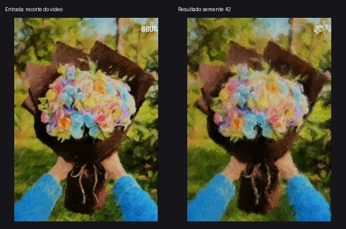

# flower_py — pintura pastel animada

Transforme uma imagem em traços de giz pastel, dos volumes de cor aos detalhes. Aplicativo local com interface gráfica e exportação de PNG/GIF pelo terminal.




O exemplo usa o recorte já pintado `Pastel_Animado/Buque_do_video.png`, presente no projeto original. Não é uma fotografia original; para avaliar a transformação de fotos, use uma foto própria. Esta é uma implementação independente do programa mostrado no vídeo de referência.

## Instalação

Requisitos: Python 3.10+, NumPy e Pillow. A janela precisa de Tcl/Tk (no Linux, frequentemente fornecido por `python3-tk`). O modo sem janela não importa Tkinter.

```sh
git clone https://github.com/JLemosDev/flower_py.git
cd flower_py
python -m venv .venv
```

Ative com `.venv\Scripts\activate` no Windows (cmd), `.\.venv\Scripts\Activate.ps1` no PowerShell ou `source .venv/bin/activate` no Linux/macOS.

```sh
python -m pip install -r Pastel_Animado/requirements.txt
python Pastel_Animado/pastel.py
```

No Windows, também é possível abrir `Pastel_Animado/iniciar_windows.bat`.

## Exemplo reproduzível

Na raiz do repositório:

```sh
python Pastel_Animado/pastel.py Pastel_Animado/Buque_do_video.png --sem-janela --tamanho 480 --semente 42 --duracao 6 --png outputs/pintura.png --gif outputs/animacao.gif
```

Substitua a entrada por uma foto sua. Arquivos de saída existentes são sobrescritos. Execute `python examples/gerar_demo.py` para recriar as imagens deste README.

| Opção | Comportamento |
|---|---|
| `--sem-janela` | Exporta sem interface; exige imagem de entrada |
| `--png caminho` | Destino do PNG no modo sem janela |
| `--gif caminho` | Exporta GIF nos dois modos |
| `--tamanho 760` | Lado maior entre 64 e 1600; não amplia a entrada |
| `--duracao 12` | De 1 a 120 segundos; GIF acrescenta 1,8 s de pausa final |
| `--semente 42` | Repete os traços no mesmo ambiente de dependências |

O GIF cabe em 420 × 560 pixels, mantendo a proporção. A duração é arredondada à resolução de 10 ms do formato. A janela pode demorar mais se o computador não acompanhar a renderização. O botão de PNG permite salvar também a pintura parcial.

## Testes

```sh
python -m unittest discover -s tests -v
```

Os testes usam imagens sintéticas, sem internet e sem janela: exportação, duração real do GIF, semente, proporção, progresso e entradas inválidas. O fluxo do GitHub Actions executa a suíte em Windows e Linux.

Validação manual da janela: escolher e cancelar uma imagem; salvar um PNG parcial e outro completo; exportar um GIF; fechar durante a pintura e durante a exportação. Uma exportação já iniciada termina em segundo plano mesmo depois de fechar a janela.

## Organização

- `Pastel_Animado/pastel.py`: entrada compatível com os comandos originais.
- `Pastel_Animado/flower_py/`: renderização, temporização, exportação, interface e CLI.
- `tests/`: testes automatizados.
- `examples/gerar_demo.py`: recria a comparação e o GIF.
- `docs/`: resultados usados neste README.

O desenho usa cinco camadas, gradientes para seguir contornos e textura de pigmento. Veja [as notas do exemplo original](Pastel_Animado/LEIA-ME.md).
